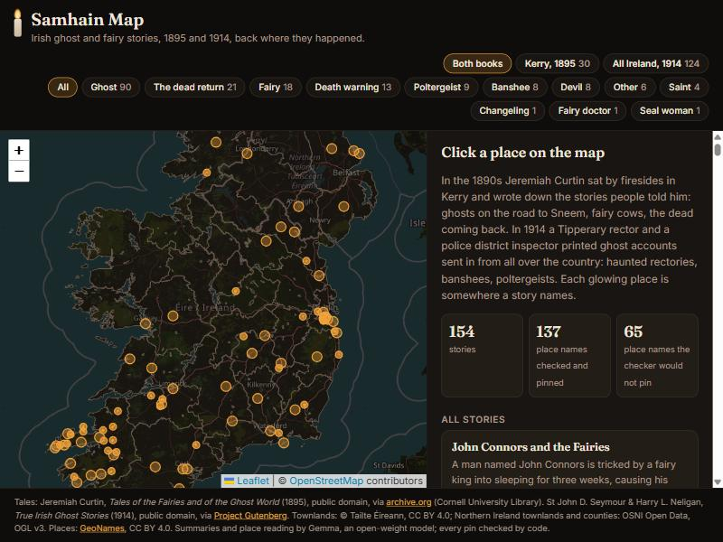

*This is a submission for the [Hacktoberfest Open-Source AI Challenge Week 4: Ghost in the Machine](https://dev.to/challenges/hacktoberfest-week4-2026-10-26)*

Halloween started here. Long before plastic pumpkins, Samhain was the night at the end of October when the Irish said the wall between this world and the other one wore thin, and the dead walked the roads.

I live in Ireland, and a few weeks ago I found out that in the 1890s an American folklorist, Jeremiah Curtin, sat by firesides in Kerry and wrote down what people told him: a man walking to Sneem at night who meets a ghost and fights it off with a steel sword, a midwife carried away to a fairy fort on a horse that turns out to be a plough beam, a drowned girl walking a strand in her bare feet asking for shoes. He printed thirty of them in 1895 as *Tales of the Fairies and of the Ghost World*.

Every one of those tales happens somewhere real. The road to Sneem. Blackwater bridge. Ventry strand. You can still walk most of them. But in the book they're just words on a page, and the old spellings (Lochlein, Rahonain) don't match any modern map.

Kerry is only one corner, though. So I added a second public-domain book: *True Irish Ghost Stories* (1914), compiled by a Tipperary rector, St John D. Seymour, and a police district inspector, Harry L. Neligan, from accounts people sent in from all over the country: haunted houses in Dublin squares, banshees, poltergeists, RIC barracks with something in them besides the police.

So I built **Samhain Map**: click a place anywhere in Ireland and read the ghost stories that happened there.

## What I Built



{{TALE VIEW SCREENSHOT OR GIF}}

- **A map of Ireland** with a glowing mark at every place the stories happen: 156 stories, 82 places in 22 of the 32 counties, north and south. Click one and you get the stories set there.
- **Each story** has a one-line summary, the line that shows its ghost or fairy, every place it names with a ✓ or ✗ and the reason, the full text, and a link to the 1895 page scan or the 1914 book.
- **Famous haunted sites**, as pale ghosts on the map: Leap Castle, Loftus Hall, Charles Fort, Kilkea Castle, Dunluce and Dunseverick castles, Clare Abbey, and Lough Leane, where O'Donoghue's ghost rides the lake on May mornings. Each one is there only because a public-domain book (1825 to 1914) tells its story, and code checked the quote word for word. Famous places none of these books tells, like the Hellfire Club, aren't on the map.
- **Filters** by what haunts the story: ghosts, banshees, poltergeists, death warnings, fairies, the dead returning, a seal woman.
- **A count of what the checker refused**, right on the front page. That number matters to me as much as the pins.

The rule behind all of it: **Gemma reads. Code decides.**

## Demo

**Live:** [samhain-map.onrender.com](https://samhain-map.onrender.com) (no sign-up, works on a phone)

Try: filter by **Ghost**, click **Sneem**, open *The Ghost of Sneem*, then scroll to "Places in this tale". Then zoom into Dublin Bay and click **Dún Laoghaire**: the 1914 story calls it Kingstown.

## Code



## How I Built It

```plaintext
1895 scan (archive.org) ─▶ code splits it into 30 tales
1914 book (Gutenberg)   ─▶ Gemma says which paragraph each account starts at ─▶ code cuts 124 accounts
each story ─▶ Gemma 4 26B (JSON mode): beings, summary, every place + the exact words it came from
           ─▶ code: is the quote really in the story? is the name in the quote?
           ─▶ code: is it a real place? (59,618 townlands from Tailte Éireann and OSNI + 31,329 GeoNames places, all 32 counties)
           ─▶ code: several places share the name? nearest the story's other places, or in the county the story names, or refuse
           ─▶ old spelling not found? Gemma suggests a modern one; code accepts it only if it exists near the story's other places
           ─▶ map
```

### Gemma only points at the text

For every place, Gemma has to return the place **and the exact words it came from**. Code then checks two things: the quote is really in the tale, and the name is really in the quote. If either fails, the place is refused, and the map says so.

Across Curtin's 30 tales, Gemma reported 95 place names. Two failed the quote check, and they surprised me: **neither was invented.** Both places are really in the tales. Gemma just changed one word while copying:

| Tale says | Gemma quoted |
|---|---|
| "…the fort **on** the place where I am living now, in Lismore." | "**in** the place where I am living now, in Lismore." |
| "…the eldest son to marry **and** Gort na Leachtan (the field of the stone heaps)…" | "**is** Gort na Leachtan (the field of the stone heaps) as fortune." |

I kept the rule strict anyway. A checker that lets "close enough" through is a checker that will one day let a made-up townland through. Losing two pins is the cheaper mistake. (The 1914 book added 223 more place names; three more failed the same check.)

### A real place, or nothing

A name that passes the quote check still isn't pinned until it matches a real place: one of 59,618 townlands (Tailte Éireann for the 26 counties, OSNI Open Data for the six in the North), or a town, hill, lake or bridge from GeoNames. "Munster", "Co. Kerry" or "the North of Ireland" are listed but never pinned: too broad to be a place you could stand.

Many names exist more than once. Ireland has 41 places called Derry and 49 called Curragh. Code decides, in this order:

1. **Nearest the story's other places.** A place with only one match anywhere is a reference point.
2. **In the county the story names.** "A haunted house in Kingstown, Co. Dublin" only looks in Co. Dublin.
3. **The only town of that name**, if nothing else in the story helps.
4. **Otherwise, refuse.** "41 places in Ireland are called 'Derry', and the story gives nothing to choose by."

That Kingstown is my favourite fix. Co. Dublin has three townlands called Kingstown, so code refused, until Gemma's modern name for it, Dún Laoghaire, turned out to be exactly one town in the county the story names. Kingstown *is* the old name for Dún Laoghaire.

### The 1914 book has no story headings

*True Irish Ghost Stories* runs 124 accounts together inside ten chapters. I didn't let Gemma rewrite or split the text. It sees each chapter with numbered paragraphs and answers only "account starts at paragraph 4, call it *The Spectral Charwoman*". Code checks the numbers exist and does the cutting, so every word on the map is the book's. The titles of those stories are Gemma's, and each one says so.

### Famous haunted sites, but only with a source

Leap Castle is the one everyone in Ireland names. The 1914 book has it, but under a made-up name: "Kilman" Castle, "perhaps the worst haunted mansion in the British Isles". Seymour gives the clue himself: its owner wrote about it in the *Occult Review* in December 1908. That was Mildred Darby of Leap Castle, and the site page says so and links the source.

The sites are a short hand-picked list, but nothing on it is taken on trust. For each one, code checks that its quote is word for word in exactly one story, and takes the location from the same gazetteer as everything else. Only Charles Fort and Dunseverick Castle, which the gazetteer doesn't have, use Wikipedia's coordinates, and say so. Gill Hall, home of the famous Beresford ghost, is in the 1914 book, but I couldn't find a source for exactly where the house stood, so it isn't a ghost on the map.

Each site has an image from Wikimedia Commons, taken only if its licence is free (all turned out CC BY-SA) and credited on the page. Kilkea Castle has none: Commons tags its postcard CC BY-SA, but the postcard's own credit line says CC BY-NC, and when two licences disagree I leave the image out.

### Mentioned is not where it happened

My first 1914 map pinned Waterloo, in Co. Cavan. The story says the widow's husband "fought at Waterloo". It also pinned the town of Shannon for "the estuary of the Shannon", and Cashel for "the diocese of Cashel". A review of every 1914 pin found them.

Gemma had already marked each place as `setting` or `mentioned`, and every one of those bad pins was `mentioned`. The 1914 contributors constantly say where they live ("the Archdeacon of Limerick sends…"), which isn't where the ghost is. So for that book only settings are pinned, and the other 65 are listed with the reason. A story whose only place is a county (*The Pig-Headed Ghost*, somewhere in Co. Cavan) is pinned on the county, marked as county-level.

### The 1890s spellings

Curtin wrote names as he heard them. *Lochlein* is Lough Leane. *Rahonain* is probably Rahinnane. Modern maps have never heard of the first spelling.

So there's a second, small Gemma pass: for every name the map couldn't find, Gemma suggests up to three modern spellings. **Code still decides.** A suggestion is accepted only if that place exists *and* lies within 30 km of the tale's other places. Those pins are labelled "via modern spelling, suggested by Gemma", so you can see which ones the model helped with.

| Curtin wrote | Gemma suggested | Code said |
|---|---|---|
| Lochlein | Lough Leane | ✓ pinned: the big lake at Killarney (two tales) |
| Skneem | Sneem | ✓ pinned |
| Awnascawil | Annascaul | ✓ pinned: a real village in the right corner of Kerry |
| Castlemain | Castlemaine | ✓ pinned (two tales) |
| Kilshanig | Kilshannig | ✓ pinned |
| Rahin | Rahan | ✗ refused: Rahan exists, but 124 km from the tale's other places (and once the map covered all Ireland, a real *Rahin* turned up in Co. Laois, refused at 244 km) |
| Dun Lean | Dunlea | not pinned: no such place |
| Drumfada | Drumfada | not pinned: no such place on modern maps |

The Rahan one is my favourite row in the project. Gemma's suggestion was a real place. It just wasn't *this* place, and only the distance check could tell.

This pass was also the flakiest part of the build. Asked about 29 names at once, Gemma reasoned past every time limit I gave it. Even 5 at a time timed out. One name per call, with a hard 150-second limit, got answers for 15 of 26 names after two runs; the rest (Rahonain among them) simply stay unpinned. In the end 8 place names are on the map because of this pass, and every one of them is labelled as a suggestion.

### Measuring it

For 7 of the shorter tales, every real place in Ireland they name was labelled by hand: 22 places. Then I compared two versions of the map: one that pins everything Gemma reported, and the real one.

| Tale | Places in the tale | Gemma found | Gemma alone would also pin | Pinned (correct / wrong) |
|---|---|---|---|---|
| The Midwife of Listowel | 1 | 1 | | 1 / 0 |
| Tom Connors and the Dead Girl | 5 | 5 | | 3 / 0 |
| James Murray and Saint Martin | 3 | 3 | "Kerry" | 3 / 0 |
| The Ghost of Sneem | 7 | 7 | | 6 / 0 |
| The Dead Mother | 3 | 3 | "America" | 2 / 0 |
| Tim Sheehy Sent Back… | 1 | 1 | | 1 / 0 |
| The Four-leafed Shamrock | 2 | 2 | | 2 / 0 |
| **Total** | **22** | **22** | **2** | **18 / 0** |

- **Gemma's reading was excellent.** It found all 22 places and invented none.
- **Every pin on the map in these tales is right.** The 4 it couldn't pin are 1890s spellings that no modern map has: Rahin, Rahonain, Drumfada and "Ventry Strand".
- **The honest limits:** it's 7 tales and 22 places, not a benchmark. {{LABEL_NOTE}} The 1914 book has no hand labels yet; its pins were checked by reading through the checker's decision list, which is how Waterloo was caught.

### Things that went wrong

- **Gemma 4 31B returned server errors all afternoon** on AI Studio, so everything ran on Gemma 4 26B (the mixture-of-experts one). Because the weights are open, switching was one line.
- **At temperature 0, Gemma 26B got stuck in its own reasoning:** "Wait, 'Sneem' is a setting. Wait, 'Blackwater bridge' is a setting." for 26,000 characters. JSON mode fixed it: about 11 seconds a tale.
- **Cork city wasn't on the map.** City centres have no townlands, so the city sits in a hole in the county outline. Points just outside the outline now count.
- **The free tier rate-limited me** halfway through. Every reply is cached per tale, so the run picked up where it stopped.
- **A Drummond in Tipperary dragged Waterville to Limerick.** In *Murderous Ghosts*, the only "Drummond" in Munster is 178 km away in Tipperary. My first checker trusted a single match as a reference point, and then picked the Waterville in Limerick because it was "nearest". Now only places in Kerry and Cork count as reference points, and a lone match that far from the rest of the tale is refused with the distance.
- **Then my fix was too strict.** Tales where someone travels to Cork city lost Dingle and Brandon Mountain, because Cork pulled the centre of the tale east. A trip to the city isn't where a tale is set, so cities no longer count as reference points.
- **Every line of the 1914 book became its own paragraph.** Saving the download on Windows doubled the line endings, and Gemma happily split 491 "paragraphs". The chapter titles came out blank, which gave it away.
- **"Waterford North Station" and "Larne River".** When a town, its station and its river sit within 4 km, they count as one place, and code first picked the wrong one to show. Now the town wins.
- **Still wrong: the Curragh.** A story where "they gallop round the Curragh", near Athy and Kilkea in Kildare, is pinned on a townland called Curragh in Co. Laois, because the River Greese, matched in Laois, pulls the story's centre that way. It's the nearest-place rule doing exactly what it says. I left it in rather than add a special case.
- **Rate limits and 500s from the free tier** for most of an evening. Every reply is cached, so two workers ran the 124 stories from both ends.

## Why Does Open Innovation Matter?

**Archives don't want their collections fed to AI companies, and I understand why.** Ireland's largest folklore archive, duchas.ie, blocks AI crawlers by name in its robots.txt. Those are people's grandparents' stories.

That's exactly why the model being open matters. Gemma's weights are public, so an archive can run this same pipeline on its own server, on its own collection, and nothing ever leaves the building. I ran it on a hosted Gemma for the demo, using a public-domain book. The National Folklore Collection could run it in-house without asking anyone's permission.

**It's checkable.** Same open model, same prompt, same public-domain book, same public maps: anyone can re-run it and argue with any pin. Every Gemma reply is committed in `data/extract/`.

**It isn't locked inside a service that might disappear.** When the bigger Gemma was down, I changed one line. If the hosted API went away tomorrow, the same weights run on a laptop.

**Where a closed model might do better:** probably the old spellings. A bigger model might know more 1890s Kerry place names. It would still need the same checker, because a confident model inventing a townland is the one thing a map of real places can't have.

## The Spirit of It

{{the moment: a place you know, or showing someone their own townland's tale}}

## Prize Categories

- **Best Use of Gemma:** Gemma 4 26B finds where each of 124 untitled accounts starts, reads all 154 stories for the beings, the summary and every place with its exact quote and role, and suggests modern spellings for old names. Every answer is checked in code before it reaches the map.
- **Best Use of Render:** the whole map is a static site deployed from a `render.yaml` Blueprint in the repo. Every push to `main` redeploys it, so each re-run of the checker goes live on its own.

---

*Tales: Jeremiah Curtin (1895), public domain, scan by Cornell University Library via archive.org. Stories: St John D. Seymour and Harry L. Neligan (1914), public domain, Project Gutenberg #14099. Haunted sites also from T. Crofton Croker (1825) and D. R. McAnally (1888), public domain, Project Gutenberg. Townland boundaries © Tailte Éireann, CC BY 4.0; Northern Ireland townlands and counties from OSNI Open Data, OGL v3. Places: GeoNames, CC BY 4.0. Built with Claude Code; I directed it and checked the results.*
